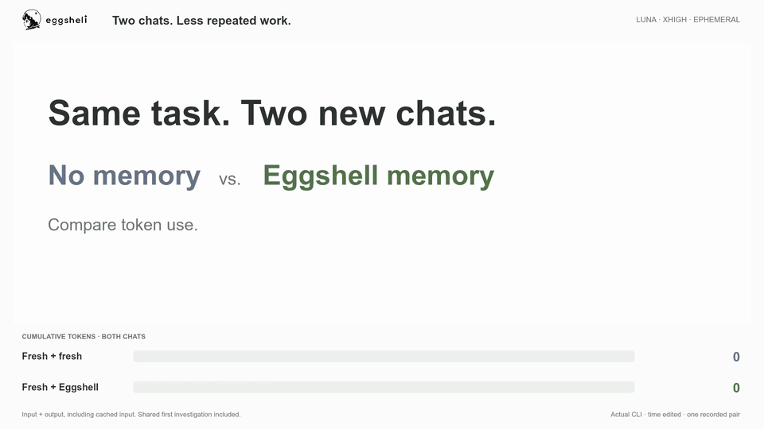

<p align="center">
  <a href="docs/assets/brand/eggshell-primary-horizontal-white.svg#gh-dark-mode-only">
    
  </a>
  <a href="docs/assets/brand/eggshell-primary-horizontal.svg#gh-light-mode-only">
    
  </a>
</p>

<p align="center">
  <strong>AI memory. Fewer tokens.</strong><br>
  Reuse prior work across independent AI agent chats, with local memory and no LLM calls to organize it.
</p>

<p align="center">
  <a href="https://github.com/momonpya/eggshell/actions/workflows/ci.yml"></a>
  <a href="lean-toolchain"></a>
  <a href="LICENSE"></a>
</p>

<p align="center">
  <a href="https://chatgpt.com/plugins/plugins_6aa482a5d9048191a727260b5f898078">Get the plugin</a> ·
  <a href="#install">Install</a> ·
  <a href="docs/try-it.md">Try it yourself</a> ·
  <a href="docs/cli-demo.md">Watch the demo</a> ·
  <a href="#how-it-works">How it works</a> ·
  <a href="#evidence">Evidence</a> ·
  <a href="#control-and-inspection">Controls</a> ·
  <a href="#privacy">Privacy</a>
</p>

Eggshell is **local memory that helps AI agents use fewer tokens**.
It saves work from one chat and makes relevant results available to a separate
chat: repository searches, commands, documentation findings, and conclusions.
It is useful when you return to related work in the same project.

Memory is built and organized locally, **without LLM calls or additional billed
tokens for memory management**. Relevant original tool results travel with their
source, conditions, and graph relationships; the next chat can use the evidence
instead of repeating the investigation. [Evidence](#evidence) reports the current
source build's LLVM comparison, token costs, answer review, and limits.

**Same task. Two new chats. Compare token use — 30 seconds.**

[](docs/cli-demo.md)

Actual Codex CLI, Luna xhigh, independent ephemeral chats on an earlier build. In this recorded pair,
Eggshell used **81.8% fewer input + output tokens in the second chat**; both
answers passed static source review. One pair, with time edited for clarity.
[Full-resolution video and measurement details](docs/cli-demo.md) ·
[Try it in two chats](docs/try-it.md).

Use the published **Codex plugin**, or the separate, experimental
[adapters for Claude Code, Gemini CLI, Cursor, and OpenCode](adapters/README.md).
The adapters use the same memory engine and are built and installed separately.
They have automated engine integration tests; live agent sessions and token
savings have not yet been evaluated for those four clients.

## Install

For **Claude Code, Gemini CLI, Cursor, or OpenCode**, follow the
[adapter installation guide](adapters/README.md#install). The steps below install
the **Codex plugin**. The [current benchmark](#evidence) identifies the measured
source commit. Release packages record their build commit in `runtime.json`;
publishing a release is separate from marketplace approval.

You need macOS or Linux on Apple Silicon/ARM64 or x86-64, Python 3, and the Codex
CLI available as `codex`. Your Codex client must support plugins and command
hooks. Setup downloads the Eggshell binary and a local search model.

1. **[Install the plugin](https://chatgpt.com/plugins/plugins_6aa482a5d9048191a727260b5f898078)**,
   then ask Codex: **“Set up Eggshell for this project.”** Setup installs the
   runtime and search model and prepares the project, preserving existing settings.
2. **Enable it in `/hooks`**, then start a new chat in the project.
3. **Check the startup message:** “Eggshell session hook connected”. Run
   **`!egg doctor`** to check setup. If the message is absent, check `/hooks`.
   Complete the [two-chat example](docs/try-it.md) and use **`!egg graph`** to
   confirm that saved work reaches the follow-up.

After initial setup, recording and relevant handoffs are automatic; ordinary
tasks need no special prompts. Missing setup produces a startup notice once the
hooks are trusted. **This integration requires Codex command hooks; ordinary
ChatGPT Chat does not provide automatic Eggshell memory.**

<details>
<summary>Install from a terminal instead</summary>

```sh
curl --proto '=https' --tlsv1.2 -fsSL \
  https://raw.githubusercontent.com/momonpya/eggshell/main/install.sh | sh
export PATH="${EGGSHELL_PREFIX:-$HOME/.local}/bin:$PATH"
cd your-project
egg init
```

The installer checks the release checksum, installs the plugin and `egg`
command, and prepares local search. Add the same PATH setting to your shell
configuration if needed. In Codex, review and enable Eggshell's hooks through
`/hooks`, then start a new chat in the project.

</details>

`egg init` creates `.eggshell.toml` and configures `.eggs/work.egg`, the project's
local memory database. The current source build stores it as a directory with
an append-only page file and a committed head. The `.eggs` directory is ignored
by Git. The database appears when the first turn is saved.

### Try it in two chats

**[Use the small public sample](docs/try-it.md)** for copyable task prompts,
baseline tests, and checkpoints for saved work and the delivered handoff.
It needs no private repository. To try Eggshell in your own project:

1. In a Codex chat in the initialized project, ask a real investigation question,
   such as “Find how configuration is loaded and identify the relevant tests.”
2. Let Eggshell save tool results as the investigation progresses and the final
   answer when the turn stops. `!egg keep` can explicitly flush the finished turn.
3. Open a separate Codex chat in the same project and ask a related follow-up,
   such as “Which tests should change if we add a new configuration option?”
4. Run `!egg graph` to inspect the prior work that was actually sent to Codex.

The leading `!` runs an Eggshell control command in Codex without a model turn.
In a terminal, use `egg init` or `egg uninstall codex` without the `!`.

**[Tell us how your first run went](https://github.com/momonpya/eggshell/issues/new?template=first-run.yml)**—
whether it worked or stopped at setup, saving, or delivery. A short report helps
us improve the steps that get in your way.

Eggshell journals each tool result before searching for related work. A separate
writer saves those observations to `.egg` while the turn is still running; the
final answer is saved when the turn stops. Interrupted writes remain queued and
retry automatically. `!egg keep` can explicitly save a finished turn; `!egg drop`
clears the active turn without removing saved observations or queued commits.

For reading multiple memory databases, custom install locations, and troubleshooting, see the
[Plugin guide](docs/codex-plugin.md).

## How it works

1. **Save original observations.** Hooks journal tool results during the turn.
   An independent writer adds immutable work and outcomes to the local page
   database, with chunked bodies, source records, and search indexes.
2. **Search the index, follow the graph.** Local MiniLM and text rankings find
   related work. Eggshell ranks the original evidence in its supporting graph
   before spending the body-read budget. It loads selected context rather than
   rebuilding the entire saved graph for every hook.
3. **Reuse checked calculations.** Persisted dependencies cover positive hits,
   missing keys, ranges, and original body references. Rankings and graph
   calculations can be reused when those dependencies agree; a new matching
   record or changed source can invalidate the relevant cached result.
4. **Deliver useful evidence.** The handoff includes selected original text,
   its provenance, necessary relationships, and a related prior explanation.
   Context competes for a bounded packet; adding more history does not entitle
   every neighboring record to more space. Conditions and exceptions must
   qualify earlier explanations. Similarity supplies context, not proof that
   the current task is complete.

Eggshell checks the recorded local file dependencies before reuse. Changed or
deleted files do not rewrite the original observation: its earlier contents
remain history, and confirmed new contents become separate observations.
Workspace-relative paths and content fingerprints support moving memory between
checkouts. A matching file name alone cannot certify an external or MCP result.

The agent is told to reuse delivered, checked evidence without reconfirming
it, obtain only missing facts needed for the current request, and report an
unavailable test as a limit. An unfinished past task does not create new work.
The final answer is saved alongside the earlier tool observations; it does not
replace them.

Search and graph processing run locally. Eggshell does not ask an LLM to write
summaries, classify memories, or maintain the graph. Selected memory and the
agent's subsequent work still consume the model's normal input and output tokens.
The engine, adapters, retrieval selection, setup logic, and package builder are
written in Lean. Python is confined to FastEmbed inference and the existing
NumPy numerical kernels; it does not organize memory or select handoffs.
See [verified contracts and runtime boundaries](docs/lean-boundaries.md).
See the [architecture reference](docs/architecture.md) for matching, graph
operations, and the Lean core.

## Control and inspection

Run these inside the relevant Codex chat:

```text
!egg                  show active settings and staged turn
!egg keep             save the staged turn now
!egg drop             clear the active turn (saved work is retained)
!egg diff             preview what would be saved
!egg graph            show the exact handoff sent to Codex
!egg why              explain the handoff selection
!egg inspect          show resolved storage paths
!egg doctor           check setup without changing settings or memory
!egg off              disable memory and clear the active turn (saved work is retained)
!egg on               enable memory again
!egg next private     read memory without saving the next turn
!egg next off         disable memory for the next turn
```

Profiles specify which memory databases can be read and where new work is saved.
The default `work` profile reads and writes the project's memory. `private`
is read-only; it still sends relevant saved work to Codex. `off` disables both
recording and handoffs. [More controls and configuration](docs/codex-plugin.md).

## Evidence

### Three LLVM topics, with and without recorded work

On **2026-10-10**, we compared three related Clang Driver investigations using
native macOS Codex CLI, **GPT-6 Luna, xhigh, independent ephemeral chats**:

1. A target/language edge case and its test boundary.
2. Public APIs, configuration, downstream effects, and a minimal additional test.
3. The interaction of `--target`, `-x`, and `-fsyntax-only` through job construction.

The source build is commit **`5aad6d9`**, against LLVM commit
`6dfe1677ab8dffbc6ec13d53a1e0215d75147689`. Production code, prompts, model, and
LLVM source stayed fixed throughout the post-commit comparison. Each fresh chat
had no Eggshell memory. The memory-assisted chats started with **an existing
seed and all three topics already recorded**. This measures reuse of known work,
not a new-seed or first-use experiment.

The first reuse lap used the same frozen binary before committing it. After the
commit, we ran fresh topics 1–3, then another reuse lap 1–3. Memory continued
saving after every topic and between laps; fresh answers were not added to it.
Both reduction columns below use the **new corresponding fresh reference**.

| Topic | Fresh tokens | First reuse lap | Reduction | Second reuse lap | Reduction |
| --- | ---: | ---: | ---: | ---: | ---: |
| 1 | 1,284,909 | 37,157 | 97.1% | 33,542 | 97.4% |
| 2 | 799,753 | 43,256 | 94.6% | 131,552 | 83.6% |
| 3 | 2,302,471 | 44,116 | 98.1% | 41,171 | 98.2% |
| **Total** | **4,387,133** | **124,529** | **97.2%** | **206,265** | **95.3%** |

Tokens are **input + output, including cached input**. Reasoning is already
included in output. These are follow-up costs; creating the existing history is
separate. There was one new fresh reference per topic and two reuse laps, with
no control over model randomness. The first lap originally compared against
older fresh references totaling 3,025,111 tokens, giving 95.9% reduction; the
table recomputes that lap against the new references.

**Question-level answer review:** the memory-assisted answers addressed the
requested source investigations, preserved the normal target/input/phase/job
boundaries, and reported that LLVM runtime tests were not run. Different
history-driven examples are not treated as quality loss. One wording
clarification is needed in second-lap topic 1: `bindings.c` checks binding and
no output; literal cc1 arguments are supported by implementation evidence,
not that test's FileCheck assertion. This was a single-reviewer, non-blinded
source audit, not a statistical accuracy or fresh-quality-equivalence estimate.

Second-lap topic 2 used two additional source reads to establish configuration
precedence, accounting for its lower savings. None of the reuse runs repeatedly
investigated an unavailable build or falsely reported a passing lit test.
The fixed snapshot had no configured LLVM build, so dynamic behavior remains
outside this study.

**Hook and persistence checks:** no timeout or incomplete initial handoff
occurred. The second lap's slowest hook was **16.4 seconds**; the first lap's
was **22.5 seconds**, within the 30-second hook deadline. Every final answer
was saved, earlier answers remained intact, and persistence/index queues were
empty before the next topic. These measurements do not establish a latency
bound for every workload; peak memory was not measured in this study.

<details>
<summary><strong>All runs, development cost, and verification record</strong></summary>

Four diagnostic calls before the frozen implementation used **346,375 tokens**:
218,401 in one earlier source-selection trial, followed by 37,625, 46,691,
and 43,658 in an intermediate three-topic trial. These are excluded from
final-code ratios and retained in the development ledger. Together with the
nine runs in the table, all 13 benchmark calls recorded for this fix used
**5,064,302 tokens**. The six post-commit calls all completed; no failed or
incomplete attempt was excluded. This is not a complete accounting of earlier
history creation.

The [measurement record](docs/benchmarks/llvm-three-topics.json) contains exact
prompts, all token counts, elapsed times, delivered packet sizes, persistence
checks, original answer and receipt hashes, answer text, and source-review notes.
Original hook payloads and logs remain local; the public record does not include
the complete prior memory database. The frozen implementation also passed
**57 core process/regression checks**. Lean contracts and their limits are
listed in [verified boundaries](docs/lean-boundaries.md).

</details>

## Privacy

Eggshell has no hosted service, telemetry, or account system. Saved work,
embeddings, and search processing stay on your machine. **Selected prior work
is passed to your agent as model input** and is handled under the settings and
terms of its model provider, just like other context in the chat.

Installation downloads the release, Python dependencies, and MiniLM model.
Work files may contain prompts, source code, and tool results; choose carefully
which files a project can read. Read-only mode prevents saving new work but
does not prevent sending existing memory to the agent.

See [PRIVACY.md](PRIVACY.md) for storage locations, network behavior, and
removal. Report vulnerabilities through the private channel in
[SECURITY.md](SECURITY.md).

## Development

Source builds use the toolchain pinned in [`lean-toolchain`](lean-toolchain).

```sh
lake build eggshell eggshell_tests
EGGSHELL_DATA_ROOT="$PWD/.lake/eggshell-tests-data" \
  .lake/build/bin/eggshell_tests
```

To install a source build:

```sh
lake build eggshell
EGGSHELL_PREFIX=/absolute/install/root \
  .lake/build/bin/eggshell install codex
export PATH="/absolute/install/root/bin:$PATH"
egg init
```

See [CONTRIBUTING.md](CONTRIBUTING.md) before changing the persistent graph or
making performance claims. Brand assets are documented in
[docs/brand.md](docs/brand.md).

Eggshell is pre-release software. Persisted data created by an incompatible
development checkout may be rejected rather than silently reinterpreted.

## License

Licensed under [Apache-2.0](LICENSE).
